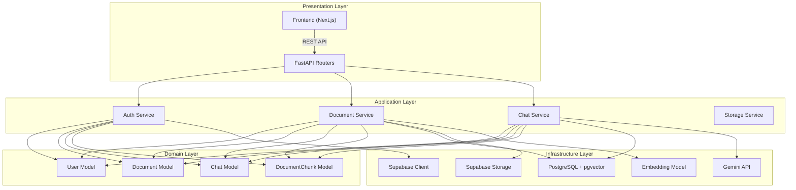
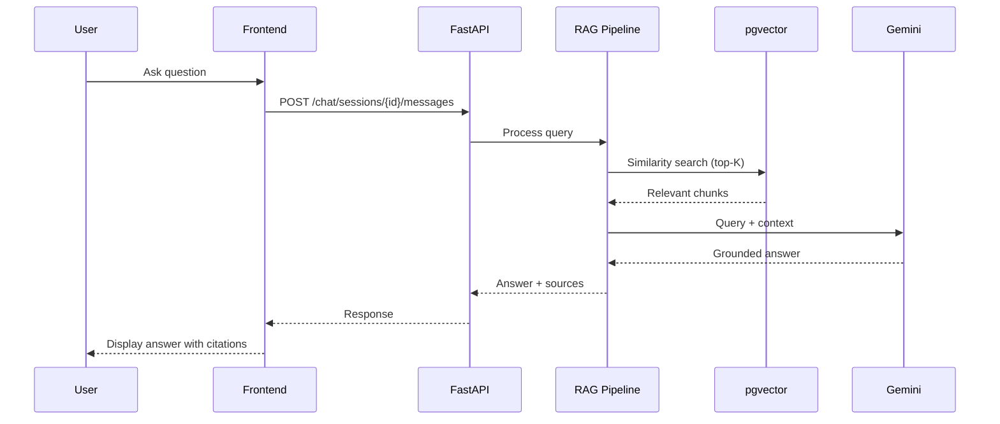

# ForgeAI Architecture

## System Overview

ForgeAI follows **Clean Architecture** with four distinct layers to ensure maintainability, testability, and separation of concerns.

## Data Flow: RAG Pipeline

## Directory Layout

| Directory | Purpose |
|---|---|
| `frontend/` | Next.js app with TypeScript, Tailwind, Shadcn UI |
| `backend/app/api/` | Presentation layer — FastAPI route handlers |
| `backend/app/services/` | Application layer — business logic orchestration |
| `backend/app/models/` | Domain layer — SQLAlchemy ORM models |
| `backend/app/db/` | Infrastructure — database sessions, Supabase clients |
| `backend/app/ai/` | AI engine — RAG pipeline, embeddings, agents |
| `database/migrations/` | SQL migration scripts for Supabase PostgreSQL |
| `docker/` | Docker Compose and Dockerfiles |

## Security

- JWT-based authentication via Supabase Auth
- Row Level Security (RLS) on all database tables
- File type and size validation on uploads
- Input sanitization on all user inputs
- CORS restricted to frontend origin
- Environment variables for all secrets
